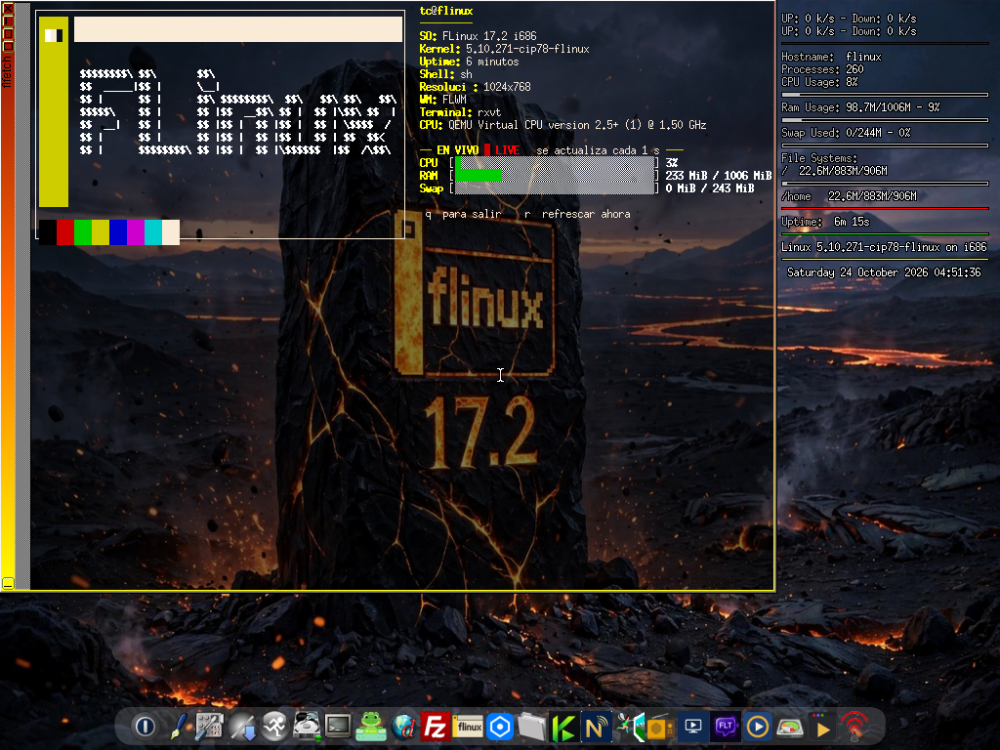
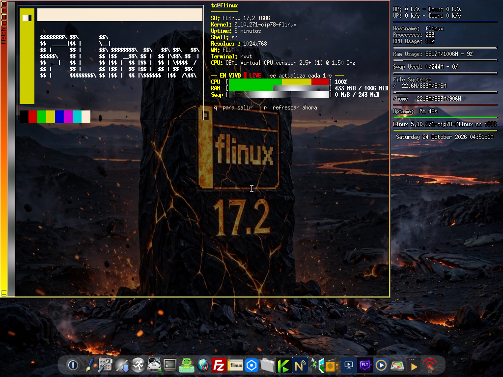

# flfetch

El fetch de **FLinux**: alternativa a Neofetch para FLinux (descontinuado) con la ficha del sistema de siempre y, a diferencia de neofetch, **CPU, RAM y Swap en vivo estilo htop**: la pantalla queda abierta y las barras se mueven cada segundo.

Escrito en **C con ncurses**, en un solo fichero fuente y sin dependencias pesadas: el binario i386 ocupa **42 KB** y el programa consume **≈ 2,2 MB de RAM** — pensado para equipos modestos.





_Capturas reales en FLinux-JC 17.2: en reposo, CPU 3 %; bajo carga, CPU 100 % y la RAM subiendo en directo._

## Qué muestra

- Marco-ventana del icono oficial de FLinux a todo el bloque izquierdo (franja amarilla con su cuadradito, barra superior y borde) con las letras ASCII «FLINUX» del banner de arranque dentro, en crema.
- Ficha con etiquetas naranjas: usuario@host, SO, kernel, uptime, shell, resolución, WM, terminal y CPU (la temperatura solo aparece si el sistema ofrece sensor térmico).
- Sección **EN VIVO**: barras de CPU, RAM y Swap con degradado verde→amarillo→rojo, refrescadas cada 1 s sin parpadeo.
- Paleta de 16 colores bajo el marco.

## Uso

```
flfetch           modo en vivo (q = salir, r = refrescar al instante)
flfetch --once    ficha estática y salir (estilo neofetch clásico;
                  también se activa solo si la salida no es una terminal)
```

Si la terminal es menor de 106×21, avisa del tamaño mínimo en vez de romperse.

## Instalación (FLinux / Tiny Core)

Descarga `flfetch.tcz` desde la [Release v1.0](../../releases/tag/v1.0) y:

```
tce-load -i flfetch.tcz
```

Dependencia: `ncursesw.tcz` (declarada en `flfetch.tcz.dep`).

## Compilar

`./build.sh` compila el binario i386 enlazando contra la libncursesw de Tiny Core; el propio script documenta la receta.

## Licencia

GPL-3.0 — ver [LICENSE](LICENSE).

**Autor:** Juan Carlos
